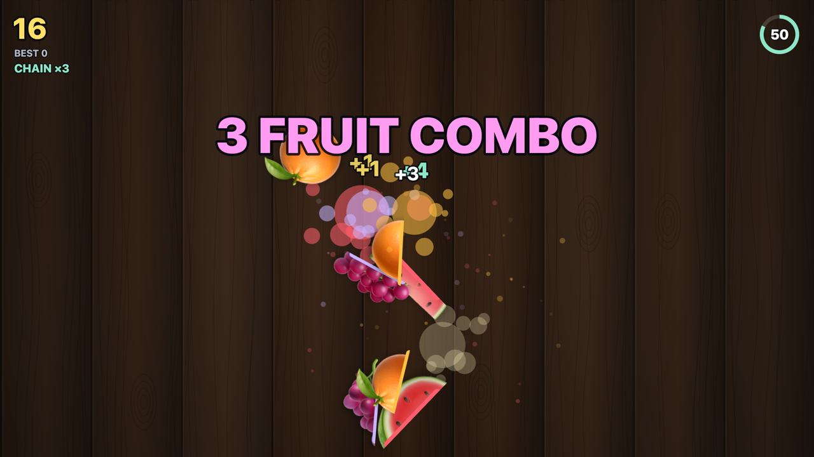

# 🥷 Ninja Motion

**Fruit Ninja you play with your body.** Your webcam tracks your hands in real time and you slice flying fruit by swinging your actual arms through the air. No webcam? It plays with a mouse or touchscreen too.

   

**▶ Play:** https://tamer-shoukri.github.io/ninja-motion/



## Features

- **Real-time hand tracking**: Google **MediaPipe HandLandmarker** detects 21 landmarks per hand, fully on-device (WebAssembly + GPU, with a CPU fallback). No video leaves the browser.
- **Speed-gated slicing**: a fruit is only cut when a blade sweeps *through* it *fast enough*, so slow hovering does nothing. It feels like a blade, not a tap target.
- **Cuts follow your swipe**: halves are the real fruit image clipped along your swipe angle, flying apart perpendicular to it with juice spray and stains.
- **Combos**: chain slices quickly for rising points, or cut 3+ fruit in a single swipe for a combo bonus.
- **Two modes, chosen by slicing a fruit**
  - **Classic**: 3 lives; bombs cost a life.
  - **Arcade**: 60 seconds; bombs cost 10 points; power-ups:
    - ❄ **freeze banana**: slow motion, clock paused
    - ✨ **frenzy banana**: fruit pour in from both sides
- **Wave spawning**: fruit come in patterns (scatter, salvos from one side, mirrored pairs) that ramp up over time.
- **Juice**:
  - a glowing blade ribbon
  - bomb fuses that crackle, explosions with hit-stop, screen shake and flash
  - score pop-ups, synthesized sound effects (`M` to mute), best score per mode
- **Plays anywhere**: mouse and touch blades alongside the camera; fruit size scales to the screen.

## How it works

```
camera ─► MediaPipe hands ─► One Euro filter ─┐
mouse / touch ──────────────────────────────┴► blades (one per hand / pointer)
                                                    │
                       speed-gated segment hit tests (new segments only)
                                                    ▼
             fruit physics + waves ─► rules (score, chains, lives / clock, power-ups)
                                                    ▼
                         effects (halves, juice, shake) ─► canvas
```

Things that took real thought:

- **Jitter vs. lag**: fingertip landmarks jitter at rest, but smoothing makes fast swipes lag. A [One Euro filter](https://gery.casiez.net/1euro/) adapts its cutoff to speed: heavy smoothing when still, almost none mid-swipe.
- **Phantom cuts**: MediaPipe can return two hands in swapped order between frames. Keying blades by list position made one "hand" teleport across the screen and slice everything in between. Blades are keyed by handedness, and any single-frame jump that's physically impossible resets the trail instead of cutting.
- **Alignment**: the video is shown mirrored with `object-fit: cover`, so landmarks are mapped through the same scale-and-crop the browser applies, and the blade stays on your finger at any window shape.
- **Only real samples**: the camera runs at ~30 fps and the game at 60+. The tracker reports when a frame is new, so the slicer never sees duplicate points that would distort swipe speed.

## Tech

- **TypeScript** + **Vite**, no framework: Canvas 2D, WebAudio, `localStorage`
- **@mediapipe/tasks-vision** `HandLandmarker`
- **Vitest**: 33 unit tests for the logic modules

## Run locally

```bash
pnpm install
pnpm dev        # open the printed localhost URL
pnpm test       # unit tests
pnpm build      # type-check + production build
```

The webcam needs a secure context (localhost or HTTPS). Stand back so both hands are in frame, with decent lighting.

## Project layout

| File | Role |
|------|------|
| `src/main.ts` | game loop, state machine, input wiring, drawing order |
| `src/hands.ts` | MediaPipe hand tracking with stable per-hand ids |
| `src/filter.ts` | One Euro filter for fingertip smoothing |
| `src/slicer.ts` | blades, speed-gated hit tests, cut angles, stroke combos |
| `src/fruit.ts` | fruit physics, wave patterns, frenzy, misses |
| `src/game.ts` | modes, scoring, chains, lives/clock, power-ups, best scores |
| `src/effects.ts` | halves, juice, stains, shake, flashes, banners |
| `src/sprites.ts` · `src/render.ts` | pre-rendered sprites, HUD and world drawing |
| `src/sound.ts` | synthesized sound effects |
| `tests/` | slicer, game rules, spawning, filter |

---

Built by **Tamer Shoukri**, part of my developer portfolio.
